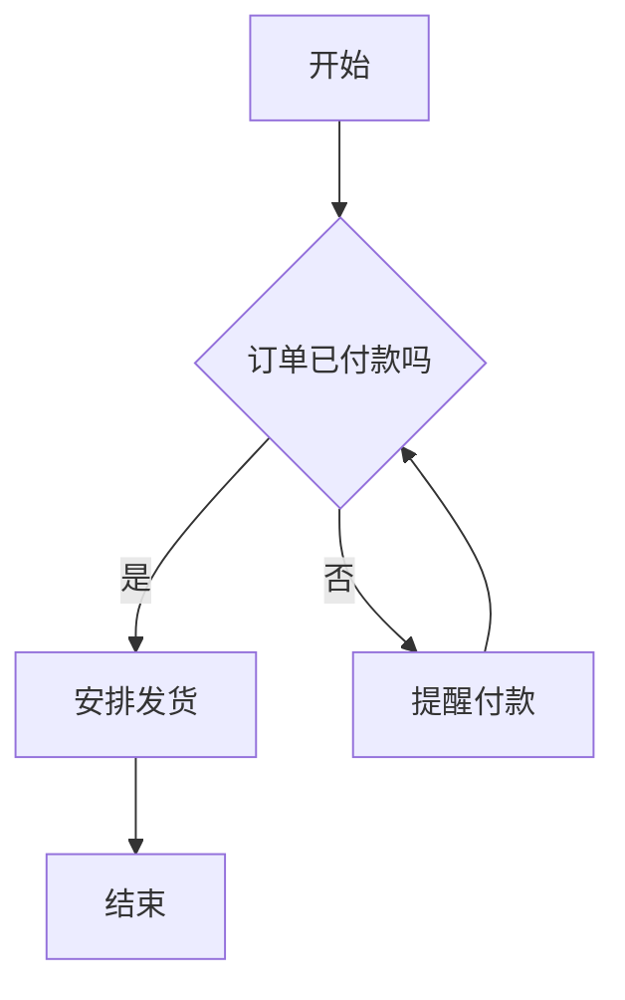

> 本文根据 OpenAI 帮助中心《Working with writing blocks and code blocks in ChatGPT》《Extracting Insights with ChatGPT Data Analysis》和 Mermaid 官方文档整理，资料核对于 2026-10-14。两张官方截图引自帮助中心，为英文界面，截图里的数据是官方的演示数据；其余配图为本站整理的示意图。

## 适用于谁

- 想让 ChatGPT 画一张流程图（业务流程、审批流程、操作步骤）的人；
- 手里有 Excel 或 CSV，想让它直接做成柱状图、折线图、饼图的人；
- 图已经出来了，想改颜色、放大、下载成图片的人。

## 结论先说

1. **ChatGPT 里画图有两条路，别混在一起：**
   - **流程图、关系图**：让它输出 **Mermaid 代码**，放在代码块里，点代码块上的 **Preview（预览）**，图就直接显示在 ChatGPT 里。官方说明代码块支持预览的类型包括 HTML 页面、React 组件、SVG 图像、**Mermaid 图**、Vega 或 Vega-Lite 图表。
   - **数据图表**：上传表格后让它做图。官方列出的类型有折线图、柱状图、饼图、直方图、散点图、箱线图、热力图、面积图、雷达图、树状图、气泡图、瀑布图；你不指定，它自己选合适的。
2. **没有 Preview 按钮不是你的问题。** 官方原话的意思是：如果 Preview 没有出现，说明这个代码块不支持预览。另外，哪些操作可用还取决于代码块类型、设备、套餐、工作区设置和账号是否开通了这个功能。
3. **交互图只有四类**：官方说，目前大多数情况下只有**柱状图、饼图、散点图、折线图**是可交互的；其他类型以静态图片返回。
4. **图表的右上角有三个操作**：下载（默认 PNG）、设置（改颜色、开关交互）、放大。
5. **图画出来要核对。** 图是根据你给的数据和描述生成的，数字、坐标轴、图例都要自己检查一遍再用。

*图：本站根据 [OpenAI 帮助中心：Working with writing blocks and code blocks in ChatGPT](https://help.openai.com/en/articles/20001246-working-with-writing-blocks-and-code-blocks-in-chatgpt) 与 [Extracting Insights with ChatGPT Data Analysis](https://help.openai.com/en/articles/9213685-extracting-insights-with-chatgpt-data-analysis) 整理的示意图*

## 一、画流程图：让 ChatGPT 输出 Mermaid，点 Preview

### 步骤

1. **说清楚流程**：告诉它起点、每一步做什么、哪里要判断、判断后分别去哪、终点是什么；
2. **指定输出格式**：让它「用 Mermaid 的 flowchart 语法，只输出一个代码块」；
3. **点代码块上的 Preview**：官方说，对支持的代码块，点 Preview 可以在 ChatGPT 里查看结果；
4. **不满意就改**：可以直接编辑代码块，也可以让 ChatGPT 帮你改；支持的代码块还能全屏打开，在 **Code** 和 **Preview** 之间切换；
5. **改动会保存在对话里**：官方说，支持的代码块里的编辑会在短暂延迟后随对话保存，后续追问时 ChatGPT 会用最新版本。注意在**临时聊天（Temporary Chat）**里，对话结束后编辑可能不会保留，见 [/guides/chatgpt-temporary-chat](/guides/chatgpt-temporary-chat)。

*图：本站根据 [OpenAI 帮助中心：Working with writing blocks and code blocks in ChatGPT](https://help.openai.com/en/articles/20001246-working-with-writing-blocks-and-code-blocks-in-chatgpt) 整理的示意图*

### 可复制的指令

> 请用 Mermaid 的 flowchart 语法画一张流程图，只输出一个代码块。方向自上而下。流程是：收到退货申请 → 判断是否在 7 天内 → 是：安排取件；否：告知不支持 → 取件后验货 → 判断商品是否完好 → 完好：退款；不完好：联系客户协商。所有节点文字用中文，并用英文双引号括起来。

写清「判断」和「去向」，是为了让图里的菱形判断节点接出两条带文字的箭头，不会漏分支。

### 一个 Mermaid 示例

下面是一个按 Mermaid 官方语法写的示例，可以直接贴给 ChatGPT 当参照，也可以让它照这个样子改：

对照下面的表读懂各部分：

*图：本站根据 [Mermaid 官方文档：Flowcharts - Basic Syntax](https://mermaid.js.org/syntax/flowchart.html) 整理的示意图*

要点：

- **第一行**声明图的类型和方向：`flowchart TD`（自上而下）或 `flowchart LR`（自左向右）。官方文档说，`flowchart` 也可以写成 `graph`；
- **节点**：`id1[文字]` 是方框，`id1(文字)` 是圆角，`id1{文字}` 是判断用的菱形；
- **中文要加英文双引号**：Mermaid 官方文档说，Unicode 文字用英文双引号括起来，所以上面示例的节点文字都写成了 `["开始"]` 这样；
- **箭头上的文字**：`A-->|文字|B`，或者 `A-- 文字 -->B`；
- **两个容易出错的地方**：节点里写**全小写的 `end`** 会让图出错，要写成 `End` 或 `END`；连接节点的名字如果以字母 `o` 或 `x` 开头，要加空格或大写，否则 `A---oB` 会被解析成圆形端点的线。

想用 Mermaid 画思维导图，见 [/guides/chatgpt-mind-map-mermaid](/guides/chatgpt-mind-map-mermaid)。

### 没有 Preview，或者预览出错

- 没有 Preview：官方说明这个代码块不支持预览；确认你让它输出的是 Mermaid 代码块，而不是普通文字；
- 点了 Preview 报错：先看上面「两个容易出错的地方」，再把错误信息或代码贴回给 ChatGPT，让它修；
- 预览要用外部资源时：官方说，预览和运行使用沙箱环境，可能会先请求你的许可；工作区管理员也可以控制是否允许；
- 想把图用到别处：把 Mermaid 代码复制出来，放进支持 Mermaid 的工具里，具体怎么导出以那个工具的说明为准（官方这篇文章没有写导出为图片的步骤）。

## 二、做数据图表：上传文件，让它生成

### 步骤

1. **上传表格**：把 Excel 或 CSV 传给 ChatGPT，上传方法和限制见 [/guides/chatgpt-excel-data-analysis](/guides/chatgpt-excel-data-analysis)；
2. **用大白话提要求**：官方说，你可以让 ChatGPT 自己决定最合适的图表类型，也可以在指令里直接说要哪一种；
3. **看图、必要时追问**：比如「改成按月份的折线图」「把前三名标出来」；
4. **用右上角的图标操作**：官方说，图表右上角可以下载或放大，下载的图表默认是 **PNG** 格式；也可以改颜色、开关交互。

*图片来源：[OpenAI 帮助中心：Extracting Insights with ChatGPT Data Analysis](https://help.openai.com/en/articles/9213685-extracting-insights-with-chatgpt-data-analysis)*

### 可复制的指令

> 请根据我上传的表格，画一张折线图：横轴是月份，纵轴是销售额，标题写「2026 年各月销售额」。如果有缺失值，先告诉我怎么处理的。

> 先看看这份数据适合用什么图表展示，给我两种方案，再按你推荐的那种画出来。

### 能画哪些类型，哪些能交互

官方列出的类型：**折线图、柱状图、饼图、直方图、散点图、箱线图、热力图、面积图、雷达图、树状图、气泡图、瀑布图**。其中大多数情况下，只有柱状图、饼图、散点图、折线图是**交互式**的（可以悬停查看数值）；其他类型是静态图片。

### 改颜色、开关交互

官方说，在图表右上角可以：

- 切换图表的**交互**开关；
- 改颜色：可以选官方的默认颜色，也可以输入颜色的**十六进制值**（比如截图里的 `0000FF`）。

*图片来源：[OpenAI 帮助中心：Extracting Insights with ChatGPT Data Analysis](https://help.openai.com/en/articles/9213685-extracting-insights-with-chatgpt-data-analysis)*

### 数据本身的问题

官方说，ChatGPT 能识别和处理数据里常见的问题：缺失值、异常值、重复行、数据类型不对。想先查一遍，可以用官方推荐的提示：「Check this data for common issues.」（中文说「检查这份数据有没有常见问题」即可）。

> 关于图里的中文标签：官方这篇文章没有讨论中文显示的问题。如果标签显示异常，本站的建议是先让它重新生成一次，说明「标签用中文」；仍不行就先用英文标签，再自己替换。

## 常见问题

**Q：ChatGPT 能直接画一张图片版的流程图吗？**
官方文档里讲的是两条路：Mermaid 代码块预览，和上传数据做图表。直接画一张图片式的流程图，可以用生图功能，但改起来不如代码块方便，需要精确文字时建议走 Mermaid；生图里写中文的情况见 [/guides/chatgpt-image-chinese-text](/guides/chatgpt-image-chinese-text)。

**Q：Preview 里能直接编辑吗？**
官方说支持的代码块可以直接编辑，也可以让 ChatGPT 帮你改；改动会随对话保存。

**Q：图表能下载成什么格式？**
官方说默认是 PNG。表格下载是 CSV。

**Q：我没上传文件，也能出图表吗？**
官方这篇文章讲的是上传文件之后生成图表；普通回答里能否直接出图表以你账号里实际看到的为准。

**Q：做 PPT 或 Word 里要用的图表怎么办？**
先在 ChatGPT 里生成并下载 PNG；需要文档里的整套内容，见 [/guides/chatgpt-create-word-excel-ppt](/guides/chatgpt-create-word-excel-ppt) 和 [/guides/chatgpt-make-ppt-prompts](/guides/chatgpt-make-ppt-prompts)。

**Q：免费账号能用吗？**
官方说明这些操作取决于套餐、设备和账号的开通情况，哪些可用以你账号里实际看到的为准。想了解各套餐差别，见 [/guides/chatgpt-plans-comparison](/guides/chatgpt-plans-comparison)；要开通 ChatGPT Plus，可以看 [/chongzhi/chatgpt-plus](/chongzhi/chatgpt-plus)。

## 参考资料

- OpenAI 帮助中心：Working with writing blocks and code blocks in ChatGPT — https://help.openai.com/en/articles/20001246-working-with-writing-blocks-and-code-blocks-in-chatgpt
- OpenAI 帮助中心：Extracting Insights with ChatGPT Data Analysis — https://help.openai.com/en/articles/9213685-extracting-insights-with-chatgpt-data-analysis
- Mermaid 官方文档：Flowcharts - Basic Syntax — https://mermaid.js.org/syntax/flowchart.html
